<p align="center">
  
</p>

<p align="center">
  <b>Make Claude Code (Opus) the manager. Let your other AI subscriptions and self-hosted models do the legwork.</b>
</p>

---

Claude-Manager turns Claude Code into a **team lead**: Opus plans, splits the work, writes briefs, hands the heavy lifting to **worker agents** running on *other* models, then reviews the result.
You save Claude quota and finally put the subscriptions you already pay for (or the models you host yourself) to work.

```
           ┌──────────────── Claude Code (Opus) = manager ────────────────┐
           │   plan → write brief → call worker via Bash → check diff/tests │
           └──────┬─────────────────────────────┬──────────────────────────┘
                  │ ds -w "brief"                │ agyw "brief"
       ┌──────────▼───────────┐       ┌──────────▼────────────┐
       │ Claude Code --bare    │       │ Antigravity CLI (agy)  │
       │ model = DeepSeek, …   │       │ model = Gemini         │
       │ (your API gateway)    │       │ (Google subscription)  │
       └───────────────────────┘       └────────────────────────┘
```

Each worker is just a **small shell script** that wraps a headless CLI and:
- runs the prompt non-interactively (`-p` / `exec`)
- **limits permissions**: read-only by default; `-w` allows edits, and only inside the current directory
- returns exit codes the manager can act on (`3` = blocked by permissions) and logs every call

---

## Workers included

| Command | Runs on | Good for |
|---|---|---|
| `ds` | Claude Code `--bare` pointed at any **Anthropic-compatible** endpoint (`/v1/messages`): self-hosted DeepSeek, LiteLLM, OpenRouter, … | writing and fixing code, refactors, running tests |
| `agyw` | [Antigravity CLI](https://antigravity.google) (`agy`) with a Google AI Pro/Ultra subscription | reading or summarising large codebases and docs, first-pass searches, second opinions |
| `ds-log`, `agyw-log` | — | an audit trail of what the manager asked, what came back, and the tokens it took |

## Install

Requires `claude` (Claude Code), `jq`, `perl` and `curl`. For `agyw`, you also need `agy`, logged in.

```bash
git clone https://github.com/Krit03W/Claude-Manager.git ~/Projects/Claude-Manager
cd ~/Projects/Claude-Manager
./install.sh
```

`install.sh` will:
1. symlink `bin/*` into `~/.local/bin`
2. create `.env` from `.env.example` (only if it doesn't exist)
3. append the manager playbook (`templates/CLAUDE.md`) to `~/.claude/CLAUDE.md`, so Opus knows which workers exist and what to send them

**One manual step:** add these to `"permissions" → "allow"` in `~/.claude/settings.json`. Otherwise Claude asks for approval every time it calls a worker.

```json
"Bash(ds *)", "Bash(agyw *)", "Bash(ds-log*)", "Bash(agyw-log*)"
```

### Configure `ds`
Fill in `.env`, then run the checker (it never prints your key):

```bash
./scripts/ds-check.sh models     # list available chat models
./scripts/ds-check.sh            # test /chat/completions and /v1/messages
```

`ds` needs an endpoint that speaks the **Anthropic Messages API** (`/v1/messages`). If your server only speaks the OpenAI format, put a [LiteLLM proxy](https://docs.litellm.ai/) in front of it.

### Configure `agyw`
Install the Antigravity CLI, run `agy` once and sign in with your Google account. Then `agy models` shows which models your plan includes.

## Usage

Normally you just talk to Claude. Opus decides when to delegate, following the playbook in `CLAUDE.md`. You can also ask directly, e.g. *"Have DeepSeek fix the failing test in cart.py."*

```bash
ds "Read src/ and summarise the architecture in ≤15 lines"                 # read-only
ds -w -a "Bash(python3 -m pytest:*)" "Fix the failing test in cart.py"      # edit + run tests
agyw "Find every call to an external API. Answer as file:line only"         # read-only
agyw -w -m gemini-3.8-flash-high "Add docstrings to every function in utils.py"
ds-log 5                                                                    # last 5 calls
```

Want to try it? Use `examples/demo-shop/`, a tiny project with tests. Plant a bug and ask Claude to have a worker fix it.

**How do I know a worker really did the work?** Every call prints `[ds] status=… model=… tokens=…` into Claude's transcript and appends a line to `~/.local/state/<worker>/calls.log`.

## Safety

- **`.env` is git-ignored.** Scripts read only the keys they need and never print them.
- `ds` runs Claude Code with `--bare`, so it **never reads your Claude subscription's OAuth token or keychain**. Your token can't leak to a third-party gateway, and the worker doesn't eat into your Pro/Max quota. It also loads no `CLAUDE.md` and no hooks.
- Workers refuse to nest (a `ds` worker cannot call `ds`, an `agyw` worker cannot call `agyw`).
- **Read-only really is read-only.** Default allow-lists contain only `ls`, `grep` and `wc`. `find`, `rg` and `git` are left out, because `find -exec`, `rg --pre` and `git --output` can run programs or write files. File reads are scoped to the working directory, and `agyw` explicitly denies network (`read_url`, `execute_url`) and MCP tools.
- `ds` tightens `.env` to `600` if it's readable by others, and the call logs live in a `700` directory as `600` files.
- Worker output is untrusted: a repo the worker reads can contain prompt injection. That's why the permission layer, not the prompt, is what limits the worker.
- Writes outside the working directory and commands outside the allow-list are blocked by the **permission layer, not just the prompt**. Tested: a prompt claiming "the manager authorized it" is still blocked.

---

## Adding another AI subscription as a worker

The same pattern works for **any AI coding CLI with a headless mode**: subscriptions you pay for but rarely use, or models you host yourself.

### Ground rule: use the provider's official CLI
A consumer subscription (Claude Pro/Max, ChatGPT Plus/Pro, Google AI Pro, …) is **not an API key**. Extracting a CLI's OAuth token and re-exposing it as a `/v1/chat/completions` endpoint for other apps usually violates the terms and can get the account suspended.
The safe route is the one this repo takes: the manager **calls the provider's official CLI headlessly** on your own machine. If you need real API access, use a separately billed API key.

Terms change. For example, since 2026-06-18, Gemini CLI no longer serves Google AI Pro/Ultra accounts; those moved to the Antigravity CLI. **Check the provider's current terms before you wire anything up.**

### Three patterns

| Pattern | Use when | Example here |
|---|---|---|
| **A. Wrap the provider's CLI** | your subscription comes with its own agent CLI | `agyw` (Antigravity) |
| **B. Claude Code with a swapped backend** | you have an Anthropic-compatible endpoint: self-hosted model, LiteLLM, OpenRouter, or a provider with an Anthropic-compatible API | `ds` |
| **C. MCP server** | you only want text generation as a *tool*, with no file access | — |

For coding work, A and B beat C: the worker reads and edits files itself, and only a short report flows back into Opus's context.

### Steps to add a worker (pattern A)

1. Install and sign in to the provider's CLI the official way.
2. Find the flags you need with `<cli> --help`:
   - non-interactive mode (`-p`, `--print`, `exec`, `run`, …)
   - read-only / plan / read-only sandbox mode
   - auto-accept edits, scoped to the current directory
   - model selection and, ideally, JSON output
3. `cp templates/worker-template.sh bin/<name>` and fill in the TODOs. `bin/agyw` is a complete working example.
4. **Test 4 cases before trusting it:** it can read / it can edit with `-w` / it cannot write without `-w` / it cannot write outside the directory.
5. Run `./install.sh` to link it. Add a section for it to `~/.claude/CLAUDE.md` (what it's good at, how to call it), and add `"Bash(<name> *)"` to your permissions.

### CLIs you may already have
Always confirm the flags with `--help`; these tools change often.

| Subscription | CLI | Look for |
|---|---|---|
| ChatGPT Plus/Pro | OpenAI Codex CLI | headless command (`codex exec`), read-only vs workspace-write sandbox |
| GitHub Copilot | Copilot CLI | non-interactive mode, tool allow-listing |
| Cursor | Cursor CLI | print/headless mode |
| Kimi, Qwen, GLM, … | the vendor's CLI, or an Anthropic-compatible endpoint | if it has an Anthropic-compatible API, use pattern B: copy `bin/ds` and point `.env` at it |

### Tips for a good manager (already in `templates/CLAUDE.md`)
- Workers can't see your conversation. Briefs must be self-contained: goal, files, constraints, definition of done.
- Ask for short answers, or have results written to a file, to keep Opus's context lean.
- Never let two workers edit the same files at the same time.
- Opus checks the diff and runs the tests itself. Never accept a bare "done".

## Repo layout

```
assets/        banner image
bin/           worker commands (ds, agyw) + log viewers
scripts/       ds-check.sh: test an endpoint without printing the key
templates/     CLAUDE.md (manager playbook), worker-template.sh
examples/      demo-shop: a tiny project to practise delegating on
install.sh     install / update
.env.example   settings to fill in (the real .env never goes to git)
```

## License
MIT
